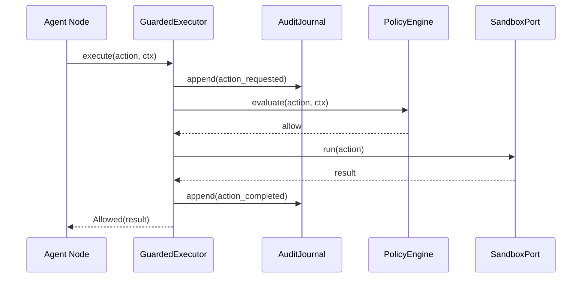
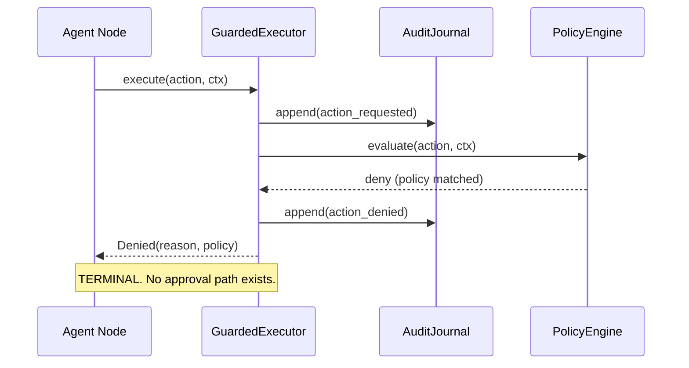
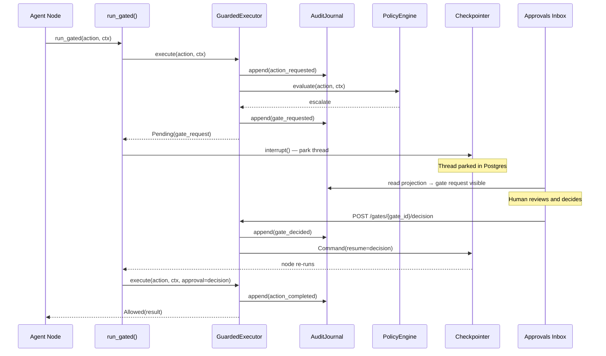
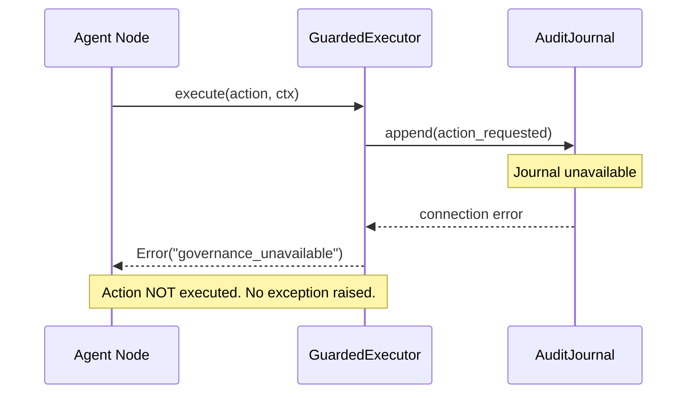

# Warden — Component Architecture

> This document provides component-level diagrams, execution flows, and trust boundaries.
> For the authoritative design decisions, see [`../ARCHITECTURE.md`](../ARCHITECTURE.md) and [`../CONTEXT.md`](../CONTEXT.md).

---

## 1. Component Map

```
┌─────────────────────────────────────────────────────────────────┐
│  Agent Layer (LangGraph)                                        │
│  ┌───────────────────────────────────────────────────────────┐  │
│  │  ops_assistant.py   (Phase 1 — PLANNED)                   │  │
│  │  draft → approval → send / abort                          │  │
│  └────────────────────────┬──────────────────────────────────┘  │
│                           │ Action(kind, name, payload, ids)     │
└───────────────────────────┼─────────────────────────────────────┘
                            │
              ┌─────────────▼──────────────┐
              │      GuardedExecutor        │   PLANNED (Phase 1)
              │      executor.py            │
              │  execute(action, ctx)        │
              │  → Allowed | Denied |        │
              │    Pending | Error           │
              └──┬──────────┬───────────────┘
                 │          │
     ┌───────────▼──┐  ┌───▼────────────┐
     │ AuditJournal  │  │ PolicyEngine   │   Both PLANNED (Phase 1)
     │  journal.py   │  │ policy/engine  │
     │  append-only  │  │ allow/escalate │
     │  write-ahead  │  │ /deny          │
     └───────────────┘  └───────┬────────┘
                                │ escalate
              ┌─────────────────▼──────────────┐
              │    HITL Re-entry Helper          │   PLANNED (Phase 1)
              │    hitl/runner.py                │
              │    run_gated() → park → resume   │
              └──────────────────────────────────┘
                         │ approve
              ┌──────────▼─────────────────────┐
              │   SandboxPort / LLM Adapter     │   PLANNED (Phase 1)
              │   sandbox.py / llm.py           │
              └─────────────────────────────────┘
                         │
              ┌──────────▼─────────────────────┐
              │   Projections (read-only)       │   PLANNED (Phase 1)
              │   projections/                  │
              │   telemetry | inbox | graph     │
              └──────────────────────────────────┘
                         │
              ┌──────────▼─────────────────────┐
              │   FastAPI + Jinja + HTMX        │   PLANNED (Phase 1)
              │   app/main.py                   │
              │   Dashboard | Inbox | Audit     │
              └─────────────────────────────────┘
```

**Implemented today:** `CheckpointManager` (checkpoint.py), domain models (models.py), demo graph (demo_graph.py), CLI harness (tests/cli_chat.py), and all tests.

---

## 2. Execution Flows

### 2a. Safe Action (Allow)



### 2b. Denied Action (Terminal)



### 2c. Pending / HITL Flow



### 2d. Error / Fail-Closed



---

## 3. Trust Boundaries

```
╔══════════════════════════════════════════════╗
║  UNTRUSTED ZONE                               ║
║  - LLM model outputs                          ║
║  - Agent-proposed tool arguments              ║
║  - User-supplied inputs                       ║
╠══════════════════════════════════════════════╣
║  GOVERNANCE SEAM — GuardedExecutor           ║
║  All actions cross here. No bypass possible.  ║
╠══════════════════════════════════════════════╣
║  TRUSTED ZONE                                 ║
║  - AuditJournal writes                        ║
║  - PolicyEngine decisions                     ║
║  - SandboxPort subprocess execution           ║
║  - LLM client with usage accounting          ║
╠══════════════════════════════════════════════╣
║  HUMAN ZONE                                   ║
║  - Named-key approver decisions               ║
║  - Policy rule edits (versioned, audited)     ║
╚══════════════════════════════════════════════╝
```

---

## 4. Journal / Checkpointer Separation (Lock 3)

This is a critical design decision. The two persistence layers serve completely different purposes.

| | AuditJournal | LangGraph Checkpointer |
|---|---|---|
| **Purpose** | Evidence — what happened and why | Control flow — where the run is parked |
| **Table** | `journal_events` | LangGraph checkpoint tables |
| **Written by** | `GuardedExecutor` | LangGraph runtime |
| **Read by** | Projections, audit UI | `graph.ainvoke(Command(resume=...))` |
| **Append-only** | Yes — immutable evidence | No — overwritten on resume |
| **Survives restart** | Yes | Yes |
| **Failure mode** | Error outcome, action not taken | Pending state lost |

**The approvals inbox reads from the journal projection, never from checkpoint state.**

---

## 5. Package Dependency Rule

```
warden/         ← governance kernel: imports nothing from app/ or agents/
app/            ← FastAPI caller: imports from warden/ only
agents/         ← graph nodes: import from warden/ only
tests/          ← imports from warden/ and tests/
```

`warden/` is a library. `app/` and `agents/` are its consumers. This boundary must never be reversed.

---

## 6. Sandbox Execution Path

```
GuardedExecutor (action.kind == tool)
        │
        ▼
  SandboxPort.run(action)
        │
        ├─── kind matches code/shell/file tool
        │         └──► subprocess with timeout + scrubbed env
        │
        └─── kind matches API/network tool
                  └──► in-process call (no subprocess needed)
```

LLM actions bypass the sandbox entirely — they go through the guarded LLM client adapter.

> ⚠️ **Security note:** A subprocess with a timeout and scrubbed environment is not equivalent to a container sandbox. It limits blast radius but does not provide filesystem or network isolation. Docker adapter is deferred unless judges require it.

---

## 7. Projection Architecture

Projections are **pure functions** over the `journal_events` table. They have no write path and are never authoritative for policy decisions.

```
journal_events (Postgres, append-only)
        │
        ├──► telemetry projection      → token cost, latency, tool usage
        ├──► inbox projection          → pending gate requests
        └──► decision_graph projection → events joined to checkpoint steps
```

All projections are read at request time. Materialization may be added if queries become slow, but this is an optimization, not an architectural requirement.

---

## 8. Phase 1 Demo Flow

The single demo covers all four governance proof points:

1. **Start run:** "email the weekly report, clean up old files, show me the orders table."
2. **Telemetry:** Dashboard fills live — tokens, cost, latency per call journaled.
3. **Deny (terminal):** `DROP TABLE` attempt → `Denied` verdict, red card: "policy: no destructive SQL — not approvable."
4. **Sandbox:** Shell `rm -rf` → contained subprocess, timeout logged.
5. **HITL gate:** Email send → `Pending` → inbox shows request with full context → approve as `alice` → email sends → timeline: `requested → decided(approve, alice) → completed`.
6. **Recovery:** Kill process mid-park, restart, resume the thread — write-ahead intent proves nothing was lost.

---

## 9. Checkpoint System (Implemented — Phase 0)

The `CheckpointManager` is the only production-ready component in the governance kernel today.

```
CheckpointManager.create(conn_string)    # async context manager
        │
        ├── AsyncPostgresSaver lifecycle  (idempotent setup)
        ├── health_check()               (probes conn or pool)
        ├── get_state_info()             (fail-closed → Error)
        ├── get_state_history()          (oldest-first ordered)
        └── resume()                     (logged wrapper, fail-closed)
```

See [`features/09_postgres_checkpoint/README.md`](features/09_postgres_checkpoint/README.md) for full documentation.

---

## 10. Layered Policy Engine Architecture (Static + DeBERTa + Granite Guardian)

To balance microsecond execution for obvious violations against deep contextual intelligence for subtle privilege escalation, `PolicyEngine` employs a 3-tier safety stack:

```
GuardedExecutor.execute(action, ctx)
             │
             ▼
  ┌────────────────────────────────────────────────────────┐
  │ L0: Static AST & Path Rules (< 1ms)                    │
  │     - SQL/Shell ASTs, forbidden path ACLs, regex       │
  └──────────────────────────┬─────────────────────────────┘
             Match           │ Clean
               ▼             ▼
          DENY / ESCALATE  ┌───────────────────────────────────────────┐
          (Early Exit)     │ L1: DeBERTa-v3 Fast Filter (10-25ms)      │
                           │     - Injection scoring, payload anomalies│
                           └─────────────────┬─────────────────────────┘
                               Score >= 0.85 │ Score < 0.20 & Read-Only
                                     ▼       │       ▼
                                   DENY      │     ALLOW (Fast-Path)
                                (Terminal)   │
                                             ▼ (Mutating or ambiguous)
                           ┌───────────────────────────────────────────┐
                           │ L2: Granite Guardian 2B/8B (80-150ms)     │
                           │     - Contextual user-intent vs role      │
                           └─────────────────┬─────────────────────────┘
                                             │
                             ┌───────────────┼───────────────┐
                             ▼               ▼               ▼
                           ALLOW          ESCALATE          DENY
                                           (HITL)        (Terminal)
```

See [`LAYERED_SAFETY_ARCHITECTURE.md`](LAYERED_SAFETY_ARCHITECTURE.md) for detailed contracts, latency budgets, and sidecar topology.
